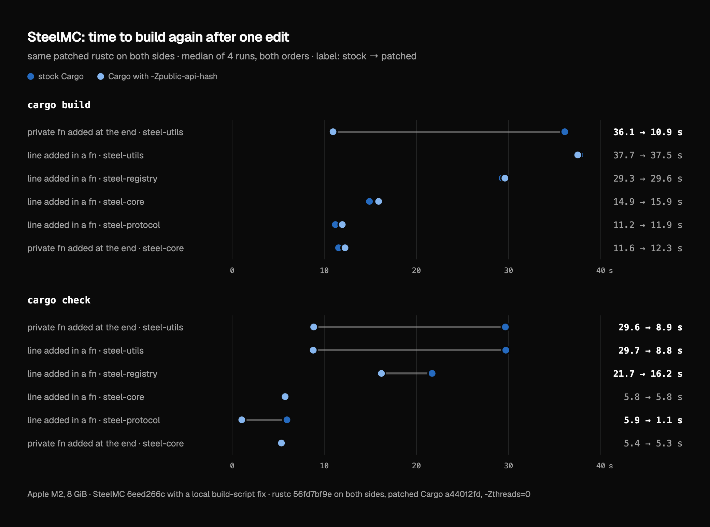

# Rust compile speed patches

Patches to the Rust compiler (rustc) and to Cargo that make some builds faster without changing what they produce. I found and measured them on [SteelMC](https://github.com/Steel-Foundation/SteelMC), a Minecraft server written in Rust, but none of them is specific to it.

> **LLM disclosure.** These patches, their tests, the measurements and this README were made with an LLM (Anthropic's Claude) and checked on my machine. Nobody else has reviewed them, and they are not submitted to rust-lang/rust or rust-lang/cargo. The [Rust LLM policy](https://forge.rust-lang.org/policies/llm-usage.html) asks for a reviewer arranged in advance, and the rust-lang/rust agent rules do not allow LLM-written code at all in soundness-sensitive areas, which include borrow checking and the query system (the second and third sets change those). The route the Rust project names for such work is the [#llm-mentoring](https://rust-lang.zulipchat.com/#narrow/channel/606558-llm-mentoring/) channel on Zulip. You are welcome to use these patches, learn from them, rewrite them, or submit your own version.

## What is here

| Set | What it fixes | Applies to | Size |
|---|---|---|---|
| [long-lines](patches/long-lines) (rustc, 4 commits) | Position lookups that walk the whole source line, so code with megabyte-long lines compiles very slowly | rust-lang/rust `822182db4` | +240 −12 |
| [borrowck](patches/borrowck) (rustc, 1 commit) | Borrow checking that grows faster than the function on huge functions | rust-lang/rust `822182db4` | +38 −2 |
| [public-api-hash](patches/public-api-hash) (rustc, 5 commits; Cargo, 1 commit) | Cargo compiles a crate again even when nothing it can see of its dependencies changed | rustc: draft PR [rust-lang/rust#156940](https://github.com/rust-lang/rust/pull/156940) at `3d5408227`; Cargo: rust-lang/cargo `29c5daa1a` | rustc +582 −64, Cargo +672 −29 |

`822182db4` is the compiler of `nightly-2026-10-14`. The long-lines and borrowck sets also apply cleanly to rust-lang/rust `main` of 2026-11-09 (`ac8310ba6`), but I built and tested them only on `822182db4`. The sets are separate: public-api-hash is based on the draft PR, the other two on `822182db4`, and I did not test them together. The patch files come from `git format-patch`, so `git am` keeps each commit with its message. Every commit message explains why the change is needed and how it was measured, in more detail than this page.

## 1. Long lines

When rustc needs a source position as "file, line, column", it used to compute the column by walking the line from its start. That is fine for normal code, but some build scripts write generated code with a whole file on one line (for example with `TokenStream::to_string()`). Then every `include_bytes!` path and every panic location walks up to megabytes, and the cost becomes (number of lookups) × (line length).

The four commits look up only the file where only the file is needed, count the width of plain ASCII text without a char walk, find columns with a binary search, and keep a small index for lines longer than 4 KiB. They are the same changes as in my earlier repo [rustc-long-line-speedups](https://github.com/OmarAfet/rustc-long-line-speedups) (which has pictures and a reproduction script), now as commits with full messages.

| Test | Before | After |
|---|---|---|
| 1,511 relative `include_bytes!` on one 2.4 MB line | 8.7 s | 1.1 s |
| 10,000 panic locations on one long line | 80.7 s | 2.1 s |
| SteelMC `steel-registry` (17 MB of generated code) | 52.4–52.9 s | 18.3–19.8 s |
| GPUI and Zed (normal short lines) | no measurable change | no measurable change |

The compiled code does not change: the test crates' object files are byte-identical, and SteelMC and GPUI binaries differ only where two builds with the same compiler also differ (a timestamp string and the code signature).

## 2. Borrow check on huge functions

Generated code sometimes has one function with thousands of local variables, for example a function that builds a huge `vec![...]`. One of the borrow checker's analyses (`EverInitializedPlaces`) kept one bit per local variable for every block of the function, so its work grew with blocks × locals.

The commit switches that set to a `MixedBitSet`, the type the other two borrow checker analyses already use. Up to 2,048 locals it is the same dense set as before, so normal functions take the same code path. Above that it is chunked, and chunks that are all zeros or all ones cost almost nothing.

| Test | Before | After |
|---|---|---|
| Borrow check of one 6.6 MB function | 4.16 s | 1.93 s |
| SteelMC `steel-registry`, borrow check part | 1.99–2.04 s | 1.79–1.87 s |

Error messages are byte-identical (a new ui test with 4,098 locals, and 15 generated cases with up to 9,621 locals).

## 3. Skip crates whose dependencies changed in ways they cannot see

This is the one with the biggest effect, and the most work left.

When you edit a crate, Cargo compiles every crate that depends on it again, even when the edit is a private function those crates can never see. In SteelMC, adding a private function to `steel-utils` runs rustc 9 times, for 7 crates, and takes 36 seconds.

The draft PR [rust-lang/rust#156940](https://github.com/rust-lang/rust/pull/156940) ("Relink, don't rebuild", from [compiler-team MCP #790](https://github.com/rust-lang/compiler-team/issues/790)) adds `-Zpublic-api-hash`: a hash of everything in a library's metadata that its dependents can observe. Two things kept it from helping in practice. Cargo does not use the hash yet. And the hash included the position of every span, so adding one line at the top of a file changed it.

The five rustc commits, on top of the PR:

1. **Fix a bug in the PR:** only the last metadata table entry of each item counted in the hash, so changing the value of a `pub const` could keep the hash, and a build system would skip a crate that really needs the new value.
2. **Backport a fix from rust-lang/rust `main`:** write the metadata stub when saved metadata is reused; without it, incremental rebuilds failed with Cargo's `-Zembed-metadata=no`.
3. **Leave out positions that dependents only use for diagnostics.** Positions that can reach machine code (debug info of generic and `#[inline]` code, shims, `#[track_caller]`) stay in. The left-out positions go into a second hash, which only incremental compilation uses, so warnings in dependents still point at the right line.
4. **Leave positions out of macro expansion hashes** (for example of `#[derive]`) under the flag. The commit message has the argument for why this is safe for incremental compilation.
5. **Report the hash** in the `--json=artifacts` notification, so Cargo can read it without parsing metadata.

The Cargo commit adds an opt-in `-Zpublic-api-hash`. When a library is dirty only because some dependencies were compiled again, and their hashes are the same as at its last real build, Cargo marks it as up to date and replays its saved messages instead of compiling it. A build script counts as changed when its output changed, and a proc macro counts as changed whenever it was compiled again. Without the flag Cargo behaves exactly as before.

### Try it

`demo/skip-demo.sh <patched cargo> <patched rustc>` makes a small workspace (`a` ← `b` ← `app`), edits `a` five ways, and prints what rustc compiled:

```
1. add a private fn at the end of a              rustc compiled: a app
2. change the body of a pub fn in a              rustc compiled: a app
3. add a line at the top of a (moves items)      rustc compiled: a app
4. add a line above a #[derive] type in a        rustc compiled: a app b
5. add a pub fn to a                             rustc compiled: a app b
program output after the steps: 191 Tagged(12); after a clean build: 191 Tagged(12) (same)
```

### Results on SteelMC



Both sides use the same patched rustc and the same flags; only Cargo differs (stock nightly Cargo vs this Cargo with `-Zpublic-api-hash`). Each number is the median of 4 runs, 2 in each order, on SteelMC master `6eed266c` with one local build-script change.

| Edit | `cargo build` | `cargo check` |
|---|---|---|
| private fn added at the end of a `steel-utils` file | 36.1 → **10.9 s** | 29.6 → **8.9 s** |
| line added in a fn, `steel-utils` | 37.7 → 37.5 s | 29.7 → **8.8 s** |
| line added in a fn, `steel-registry` | 29.3 → 29.6 s | 21.7 → **16.2 s** |
| line added in a fn, `steel-core` | 14.9 → 15.9 s | 5.8 → 5.8 s |
| line added in a fn, `steel-protocol` | 11.2 → 11.9 s | 5.9 → **1.1 s** |
| private fn added at the end of a `steel-core` file | 11.6 → 12.3 s | 5.4 → 5.3 s |

With `cargo check`, every edit skipped all the dependents it could (in one of the four `steel-registry` runs it did not; see Limits). `steel-core` edits gain nothing, because `steel-core` itself is most of the time. With `cargo build`, the private fn in `steel-utils` skips all dependents. The private fn in `steel-core` skips `steel-login` but is not faster. Edits that add a line inside a function compile everything again, and there the patched side is a little slower.

## How it was tested

All on one Mac (Apple M2, 8 GiB, macOS 15), with stage-1 compilers built the same way with and without the patches.

- **long-lines:** each commit passes the `rustc_span` tests; a new test compares line, column and display column at every char boundary of seven tricky files with the original algorithm written out (it passes with and without the patches). On the final commit: `tests/ui` 0 failed, `rustc_span` 44 and `rustc_codegen_ssa` 11 unit tests passed, `tidy` clean. Earlier runs of the same code: `tests/ui` 22,224, plus `ui-fulldeps`, `incremental`, `codegen-llvm`, `codegen-units`, `assembly-llvm`, `mir-opt`, `pretty`, `crashes`, `run-make`, `rustdoc-ui`: 0 failed.
- **borrowck:** `tests/ui` 22,224, `mir-opt` 416, `incremental` 176, `ui-fulldeps` 30: 0 failed (same code before it became a commit); `tests/ui/borrowck` and `tests/ui/nll` (1,029) with the new test.
- **public-api-hash, rustc:** `tests/ui` 21,766, `tests/incremental` 184, `tests/mir-opt` 408, `tests/ui-fulldeps` 29: 0 failed; `tidy` clean at every commit. Every new test fails without its commit (checked by removing each commit). With `-Zpublic-api-hash` forced on for every test, `tests/incremental` passes 184/184 and 58 of 22,184 ui tests fail; the unmodified PR fails the same 58 tests in the same ways, so none of them comes from these commits.
- **public-api-hash, Cargo:** 8 new tests, checked by breaking the feature on purpose (never skip, always skip, ignore cached warnings: the matching tests fail). Cargo's full test suite with a stock nightly rustc: 4,395 passed, 7 failed: the 6 new tests that need the patched rustc (with it, all 8 new tests pass), and 1 test that needs an x86_64 target this Mac does not have.
- **public-api-hash, end to end:** when Cargo skips a crate, the final binary's machine code and debug info are byte-identical to a full rebuild (6 kinds of edits).

## Limits

- **This is not "milliseconds".** The best result is one kind of edit going from 36 s to 11 s. Most of what is left is the edited crate itself and the final binary, which still compile and link in full.
- **In normal builds, most real edits still compile all dependents.** Adding a line inside a function moves everything below it, and if any of that is derived, generic or `#[inline]` code, dependents copy its line numbers into their own debug info, so they really change. The hash covers the whole crate, not only the items a dependent uses. `cargo check` does not have this problem, because no position reaches machine code there.
- **The public hash is not always the same for the same source.** In SteelMC, `steel-registry` got one hash after a fresh compile and another after an incremental compile, with every input file byte-identical (all 1,780 checked) and the same command. So the first edit after a full build compiled all dependents again. This only causes extra rebuilds, not wrong skips, but I do not know the cause yet, and a hash that depends on the build history means something is not fully understood.
- **When there is nothing to skip, the patched side was 0.3–1.0 s slower** in some SteelMC edits. I did not find where: rustc's own measured passes show no difference.
- **The weakest part for correctness** is the list of places where a definition's position can reach machine code (commit 3). It came from reading every such use in the code generator. If a future compiler change adds a new use, a skipped crate could keep an old line number in its debug info. A check in the code generator would make this safer; it is not there yet.
- **The draft PR itself is not finished with the flag on.** With `-Zpublic-api-hash`, 58 ui tests fail with and without my commits: 7 compiler panics (externally implementable items, `expect_local` on another crate's symbol), 6 programs that should compile but do not (macros 2.0 that reach private items of another crate), and in most of the rest the error messages change (for example, a suggestion that points at a private item of another crate is missing). Do not turn the flag on for code you depend on.
- The third set sits on an unmerged draft PR, so it needs a rebase whenever the PR changes. The Cargo commit applies to Cargo master of 2026-11-10 only with `git am -3` (three-way merge, no conflicts); I only built and tested it on `29c5daa1a`.
- One machine, a few runs per measurement, and macOS only.

## Build it

Compiler (both rustc sets build the same way):

```bash
git clone https://github.com/rust-lang/rust && cd rust
# long-lines and borrowck:
git checkout 822182db4c4a1827256881d8c7aa685f0bcf2b11
git am /path/to/patches/long-lines/*.patch /path/to/patches/borrowck/*.patch
# or public-api-hash, on top of the draft PR:
#   git fetch origin pull/156940/head && git checkout 3d5408227
#   git am /path/to/patches/public-api-hash/rustc/*.patch
cat > bootstrap.toml <<'EOF'
profile = "compiler"
change-id = "ignore"
[build]
compiler-docs = false
extended = false
[rust]
debug-logging = false
debug-assertions = false
debuginfo-level = 0
incremental = false
channel = "nightly"
[llvm]
download-ci-llvm = true
EOF
./x build --stage 1 library
rustup toolchain link my-rustc build/host/stage1
```

Cargo (only for public-api-hash):

```bash
git clone https://github.com/rust-lang/cargo && cd cargo
git checkout 29c5daa1a
git am /path/to/patches/public-api-hash/cargo/*.patch
CFG_RELEASE_CHANNEL=nightly cargo +nightly-2026-10-14 build --release
```

`CFG_RELEASE_CHANNEL=nightly` makes the self-built Cargo act like a nightly Cargo. Without it, Cargo does not pass `-Zembed-metadata=no`, writes the metadata twice, and every build gets slower, which makes comparisons wrong.

Use it in a project:

```bash
RUSTC=/path/to/rust/build/host/stage1/bin/rustc /path/to/cargo/target/release/cargo -Zpublic-api-hash build
```

or put `public-api-hash = true` under `[unstable]` in `.cargo/config.toml`.

## License

The patches change rust-lang/rust and rust-lang/cargo and are offered under the same terms: MIT or Apache-2.0 ([LICENSE-MIT](LICENSE-MIT), [LICENSE-APACHE](LICENSE-APACHE)).
